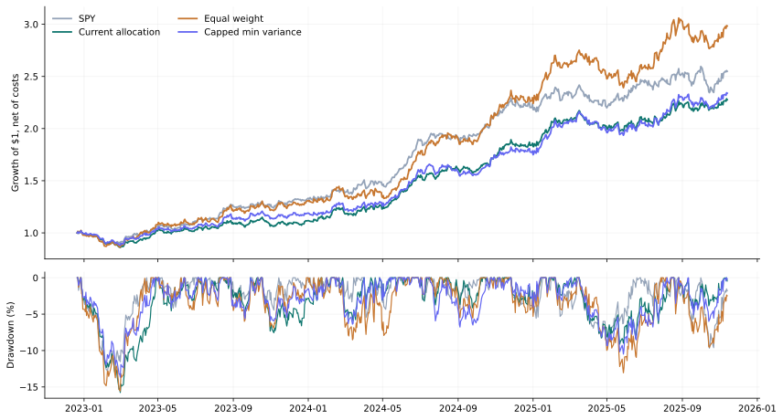

# PortfolioLens

**A portfolio review prototype for financial analysts — and a product case study in making financial tradeoffs easier to explain.**

PortfolioLens compares an existing allocation, an equal-weight baseline, and a capped minimum-variance alternative against SPY. It produces a portable HTML decision brief, performance measures, rebalance logs, and a reproducible run record.

**Status:** working research MVP. Offline demo and automated tests are included. User interviews, usability findings, and measured business impact are pending. This is an independent extension of an APAN 5540 team project; it does not claim independent discovery of the original strategy or verified investment alpha.



*The image above uses explicitly synthetic prices. It demonstrates the workflow, not actual AVGO, ETN, PGR, or SPY performance.*

## Run the demo

Python 3.11 or newer:

```bash
python3 -m venv .venv
source .venv/bin/activate
python -m pip install -e '.[dev]'
python -m portfoliolens review --demo --output reports/demo
python -m pytest -q
```

Open `reports/demo/review.html` in a browser. The report is self-contained and works offline. On macOS: `open reports/demo/review.html`.

For an immediate preview without installation, download and open [the committed synthetic report](examples/demo/review.html). GitHub displays its source rather than rendering the HTML. The [demo notebook](notebooks/01_portfolio_review.ipynb) walks through the same analysis and a 0/10/25 bps cost sensitivity.

## The user and decision

**Provisional user:** an analyst at a small investment advisory firm preparing a recurring portfolio review.

**Job to be done:** “Help me see where the portfolio is concentrated, compare practical alternatives, and explain the tradeoff in a review memo.”

The supplied illustrative allocation is AVGO 18.4%, ETN 12.6%, PGR 69.0%, taken from the original team project. PortfolioLens makes the concentration visible and compares it with a 50% target cap. This is a retrospective allocation scenario, not a clean stock-selection backtest.

## What works today

- Configurable holdings CSV and adjusted daily price CSV inputs.
- Clear errors for missing prices, invalid weights, insufficient history, and infeasible caps.
- Monthly rebalancing, weights drifting between trades, initial entry costs, and transaction costs on gross traded notional.
- A rolling 252-observation covariance fit using only returns available before each evaluated interval.
- Total return, annualized geometric return, volatility, drawdown, Sharpe ratio, benchmark information ratio, beta, and turnover.
- A decision brief, embedded performance chart, metrics CSV, per-strategy trade logs, net-return CSV, and run metadata with a data fingerprint.
- A deterministic synthetic demo requiring no market-data service.

## Use market data

```bash
python -m pip install -e '.[market]'
python -m portfoliolens download --start 2019-01-01 --end 2026-11-21 --output data/prices.csv
python -m portfoliolens review --prices data/prices.csv --holdings examples/holdings.csv --max-weight 0.5 --cost-bps 10 --annual-rf 0.04 --output reports/market
```

The download end date is exclusive. Market data is fetched on demand from Yahoo Finance through yfinance and cached locally with provenance; vendor files are not distributed in this repository. Download availability is not guaranteed. The offline demo is an explicit separate mode, never a silent fallback.

Custom price schema: first column `date`, followed by positive, finite adjusted-price columns for every holding and the benchmark. Use daily observations on a consistent trading calendar. Holdings schema:

```csv
ticker,weight
AVGO,0.184
ETN,0.126
PGR,0.690
```

Weights are decimal fractions summing to 1. The three-stock example requires a cap of at least 1/3. The cap applies to optimized targets; actual weights can drift above it between rebalances. The current-allocation comparator intentionally keeps the supplied weights, even when they exceed that cap.

## Financial interpretation

- The fixed universe and supplied weights are retrospective. Rolling estimation prevents future returns from entering covariance fits; it does not remove historical selection or survivorship bias.
- The 4% risk-free rate is a configurable constant assumption, not a downloaded historical rate.
- All series pay the same modeled initial entry cost. Rebalance costs use buys plus sells, not half-turnover. No exit liquidation, taxes, market impact, or changing spreads are modeled.
- Annualization uses 252 observations per year. Total return and annualized return are different fields.
- Covariance uses a fixed 10% diagonal shrinkage. No return prediction or alpha significance claim is made.
- Minimum variance is a different objective from the original project's maximum-Sharpe optimization. See [methodology](docs/METHODOLOGY.md).

## Finish this week

The [one-week plan](docs/WEEK_PLAN.md) targets an interview-ready case study by **Sunday, November 29, 2026**. The existing MVP is the technical starting point; the remaining work emphasizes one verified market case, feedback, and a concise demo.

- [Validation record](docs/VALIDATION.md)
- [Product brief and acceptance criteria](docs/PRODUCT_BRIEF.md)
- [PM and financial analyst pitch](docs/INTERVIEW_PITCH.md)
- [Methodology and known limitations](docs/METHODOLOGY.md)
- [Source lineage and contribution boundaries](docs/PROVENANCE.md)

## Repository map

```text
portfoliolens/   analysis engine, data adapters, report renderer, CLI
notebooks/      reproducible walkthrough and cost sensitivity
examples/       holdings and a generated synthetic report
tests/         calculation, timing, validation, and report tests
docs/          product scope, methodology, weekly plan, interview narrative
```

The MVP runs locally. A hosted application, user authentication, live trading, and an AI recommendation layer are outside this week's scope.
